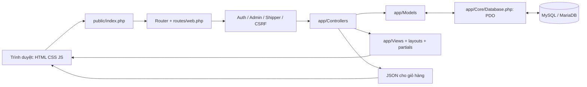
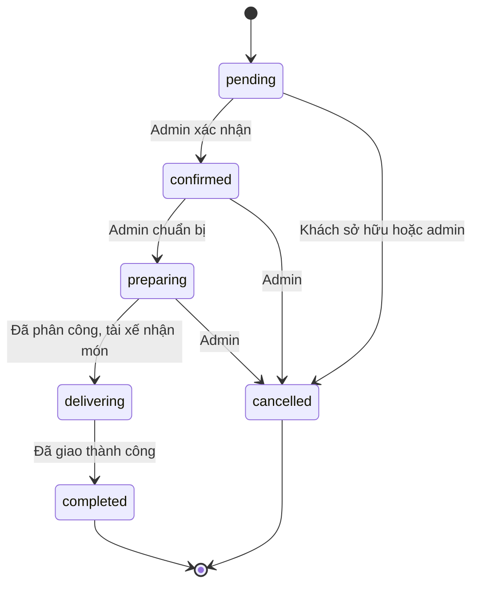
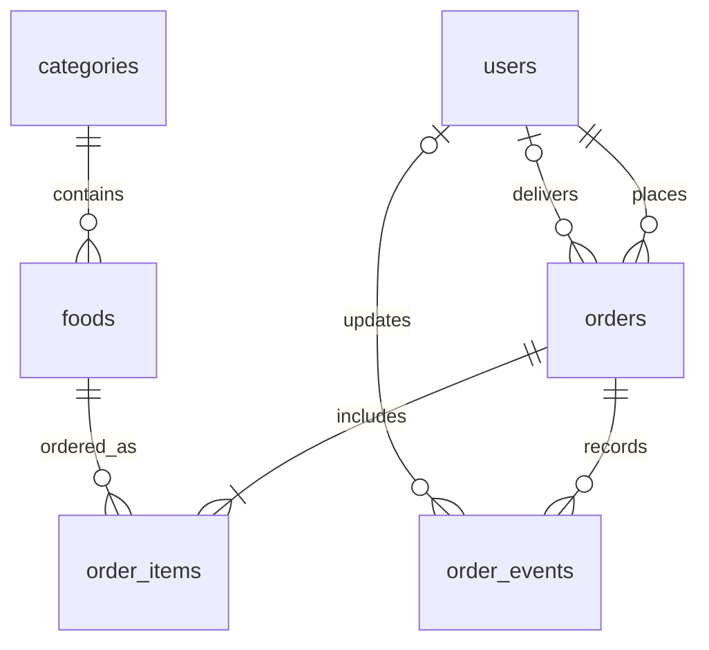

# Kiến trúc MVC của Yumio

Yumio giữ PHP MVC thuần của nhóm, HTML/CSS/JavaScript và MySQL/MariaDB. Không chuyển framework, không thêm Java hay hệ thống build. Leaflet là thư viện bản đồ duy nhất được bổ sung theo yêu cầu đồ án.

## Ba phần của hệ thống

| Thành phần | Trách nhiệm | File/thư mục thực tế |
| --- | --- | --- |
| Frontend | Giao diện thực đơn, giỏ hàng, checkout, quản trị, giao hàng; gửi form hoặc fetch | `app/Views/`, `public/assets/css/` (gồm `yumio-theme.css`), `public/assets/js/` (gồm `checkout.js`, `address-search.js`, `motion.js`) |
| Backend | Session, định tuyến, kiểm tra đầu vào/CSRF/quyền, tính tiền và xử lý nghiệp vụ | `public/index.php`, `app/bootstrap.php`, `routes/web.php`, `app/Controllers/`, `app/Middlewares/`, `app/Core/` |
| Database | Lưu người dùng, món/danh mục, đơn/chi tiết, phân công và tiến trình giao hàng | `database/schema.sql`, `database/seed.sql`, `database/migrations/001_delivery.sql`; kết nối tại `config/database.php`, `app/Core/Database.php` |

View PHP được render tại server; HTML/CSS/JS mà nó tạo ra là frontend chạy trên trình duyệt. MySQL là dịch vụ riêng của XAMPP, không nằm trong trình duyệt.

## Sơ đồ xử lý MVC

Khi dùng PHP built-in server, `public/router.php` phục vụ file tĩnh trong `public/` và đưa request ứng dụng vào `public/index.php`. Khi dùng Apache, `public/.htaccess` làm nhiệm vụ rewrite. Chỉ `public/` nên là document root.

## Model, View và Controller cụ thể

| Chức năng | Controller | Model | View |
| --- | --- | --- | --- |
| Trang chủ, cửa hàng | `app/Controllers/HomeController.php` | `Food`, `Category` | `app/Views/home/` |
| Thực đơn, tìm kiếm, chi tiết | `app/Controllers/FoodController.php` | `app/Models/Food.php`, `Category.php` | `app/Views/food/` |
| Giỏ hàng | `app/Controllers/CartController.php` | `app/Models/Cart.php`, `Food.php` | `app/Views/cart/index.php` |
| Đăng ký/đăng nhập | `app/Controllers/AuthController.php` | `app/Models/User.php` | `app/Views/auth/` |
| Đặt/hủy/lịch sử đơn | `app/Controllers/OrderController.php` | `app/Models/Order.php`, `OrderItem.php`, `Delivery.php` | `app/Views/order/` |
| Gợi ý địa chỉ | `app/Controllers/AddressController.php` | `app/Models/Geocoder.php` | Combobox trong checkout, `public/assets/js/address-search.js` |
| Quản lý món/danh mục | `app/Controllers/Admin/FoodController.php`, `CategoryController.php` | `Food`, `Category` | `app/Views/admin/food/`, `admin/category/` |
| Quản lý và phân công đơn | `app/Controllers/Admin/OrderController.php` | `Order`, `User`, `OrderItem` | `app/Views/admin/order/` |
| Nhân viên giao hàng | `app/Controllers/ShipperController.php` | `Order`, `OrderItem` | `app/Views/shipper/` |

Controller nhận request, kiểm tra đầu vào, gọi Model và trả HTML/JSON/redirect. Các truy vấn SQL nằm trong Model hoặc lớp kết nối; View không chứa SQL. `app/Core/Controller.php` nạp danh mục điều hướng chung rồi truyền cho header, thay cho truy vấn từ View. View có thể đọc hằng số nhãn trạng thái và số lượng giỏ session để hiển thị.

`Cart` là Model lưu dữ liệu session, không có bảng giỏ hàng. `Delivery` là Model nghiệp vụ kiểm tra toạ độ/tính khoảng cách, không có bảng riêng. `app/Core/Model.php` chứa các thao tác CRUD dùng lại; các tên bảng/cột truyền vào do code ứng dụng xác định, giá trị dữ liệu dùng prepared statement.

## Luồng đặt COD

1. Browser POST `/cart/add`, `/cart/update` hoặc `/cart/remove` với CSRF. `CartController` kiểm tra số lượng 1–50; `Cart` lưu `[food_id => quantity]` trong session. Giá luôn lấy từ `foods`.
2. GET `/checkout` yêu cầu đăng nhập. Controller đọc giỏ, tạo token checkout và ảnh chụp ID/giá/số lượng đã hiển thị. Mỗi lần mở checkout có token mới để tab cũ không gửi giỏ đã thay đổi.
3. Khách nhập tên, điện thoại, địa chỉ, ghi chú. Gợi ý địa chỉ/ghim là tuỳ chọn. POST `/checkout/review` kiểm tra CSRF, token, thông tin và giỏ, rồi chỉ render trang xem lại; không ghi đơn. Session lưu chữ ký của thông tin đã xem.
4. Khách chủ động nhấn nút xác nhận ở trang xem lại. POST `/checkout` yêu cầu `checkout_action=confirm`, kiểm tra lại CSRF, token, chữ ký dữ liệu và giỏ. Form nhập liệu không thể gửi trực tiếp tới bước tạo đơn bằng Enter.
5. `Order::place()` mở transaction, khoá các dòng món bằng `SELECT ... FOR UPDATE`, kiểm tra còn bán/giá/số lượng, tự tính subtotal/phí/tổng. Không tin tổng tiền do client gửi.
6. Lưu `orders`, các dòng `order_items` và sự kiện đầu tiên trong `order_events`, rồi commit. Chi tiết lưu giá và tên món tại thời điểm đặt. Cột `checkout_token` có UNIQUE để tránh đơn trùng.
7. Sau commit mới xoá giỏ session và redirect `/orders/{id}`. Nếu transaction lỗi thì rollback và giữ giỏ; thay đổi giá/giỏ yêu cầu khách xem lại checkout.

PHP PDO bật strict mode riêng cho kết nối để database không âm thầm cắt hoặc làm tràn giá trị khi XAMPP đang dùng SQL mode lỏng. Không sửa SQL mode toàn server.

Phí giao hiện tại: 15.000₫ cho đơn dưới 200.000₫; miễn phí từ 200.000₫. Phí không phụ thuộc ghim hay khoảng cách.

## Phân quyền và giao hàng

| Vai trò | Quyền |
| --- | --- |
| `customer` | Đặt hàng, xem đơn của chính mình, hủy khi `pending` |
| `admin` | Quản lý món/danh mục, xem mọi đơn, xác nhận/chuẩn bị/phân công, cập nhật trạng thái hợp lệ, cấp vai trò shipper cho khách |
| `shipper` | Xem đơn được phân công, chuyển `preparing → delivering → completed`; không vào quản trị |

Các route bảo vệ dùng `AuthMiddleware`, `AdminMiddleware`, `ShipperMiddleware`, `CsrfMiddleware`. Auth middleware đọc lại người dùng từ database cho request được bảo vệ, nên thay đổi vai trò có hiệu lực ở request kế tiếp. Đăng ký luôn tạo khách; endpoint cấp quyền không cấp admin.

Admin phân công khi `confirmed` hoặc `preparing`; không đổi tài xế sau khi bắt đầu giao. `Order::transition()` và `Order::assign()` khoá cùng dòng đơn trong transaction, kiểm tra lại quyền/trạng thái và ghi lịch sử để tránh ghi đè đồng thời. Đơn kết thúc không được mở lại. Admin có thể cập nhật các bước giao hợp lệ khi cần demo, nhưng bắt đầu giao vẫn yêu cầu đã có tài xế.

Khách xem timeline và lịch sử thời gian qua `app/Views/partials/order_events.php`; nút làm mới tải trạng thái mới nhất. Chưa dùng polling, WebSocket hay GPS tài xế liên tục.

## Database và quan hệ

- `users`: tên/email/hash mật khẩu, điện thoại, vai trò.
- `categories`, `foods`: thực đơn và trạng thái đang bán. Món đã có trong đơn không bị xoá do khoá ngoại RESTRICT; chức năng quản trị cũ chuyển sang ngừng bán khi cần.
- `orders`: người đặt, thông tin nhận, tiền, COD, trạng thái, `shipper_id`, token và toạ độ/khoảng cách.
- `order_items`: món, số lượng, giá và tên món chụp tại lúc đặt. Đơn cũ chưa có `food_name` dùng tên hiện tại làm phương án tương thích.
- `order_events`: đơn, trạng thái, người thao tác, mô tả, thời gian. Đơn mẫu cũ có thể chưa có lịch sử.

`database/schema.sql` dùng cho database mới. `seed.sql` chỉ nạp một lần, không còn TRUNCATE. Database đã chạy không import lại seed. `scripts/migrate.php` kiểm tra từng cột trước khi bổ sung schema cũ; cần sao lưu trước nâng cấp. Chưa chạy migration trên database hiện tại vì người dùng đã import schema mới đủ cột.

## Bản đồ và giới hạn tích hợp

`app/Views/partials/delivery_map.php` được dùng chung ở checkout, trang xem lại, chi tiết khách, admin và tài xế. `public/assets/js/delivery-map.js` tải Leaflet khi bấm mở hoặc chọn gợi ý địa chỉ; JS/CSS phiên bản 1.9.4 lưu tại `public/vendor/leaflet/`, kèm LICENSE.

Khách chọn gợi ý địa chỉ Việt Nam từ Photon hoặc nhấp/chạm bản đồ để ghim; cũng có thể xin vị trí thiết bị hoặc bỏ ghim. `AddressController` nhận query đã đăng nhập; `Geocoder` gọi API Photon qua HTTPS, lọc Việt Nam, cache kết quả ngoài public/ và giới hạn tần suất. Không ghi dữ liệu geocoding vào schema hay gọi nó trong transaction đặt đơn. Chi tiết giới hạn/chính sách ở [UI_UX.md](UI_UX.md).

`Delivery::location()` vẫn kiểm tra phạm vi toạ độ và tính Haversine phía server từ điểm xuất phát trong `config/delivery.php`. Không cần API key cho Photon demo. Khoảng cách là đường chim bay; chưa có tuyến đường lái xe, nhiều chi nhánh tự chọn hoặc GPS tài xế thời gian thực.

Nếu thư viện/nền bản đồ/định vị lỗi, giao diện báo phương án dùng địa chỉ và vẫn cho đặt COD. Không gọi dịch vụ bản đồ trong transaction đặt đơn. Giữ attribution OpenStreetMap và chỉ tải nền khi người dùng mở bản đồ; xem [chính sách tile](https://operations.osmfoundation.org/policies/tiles/) và [API Leaflet 1.9.4](https://leafletjs.com/reference-1.9.4.html).

## Chạy và demo

Lệnh Windows và tài khoản ở [README](../README.md), hướng dẫn database ở [MYSQL_SETUP.md](MYSQL_SETUP.md), kết quả xác minh ở [TEST_REPORT.md](TEST_REPORT.md). Chỉ sử dụng dữ liệu giả cho đồ án; các thao tác COD/giao hàng là nghiệp vụ demo trong database, không phát sinh thanh toán hay giao hàng ngoài đời.
